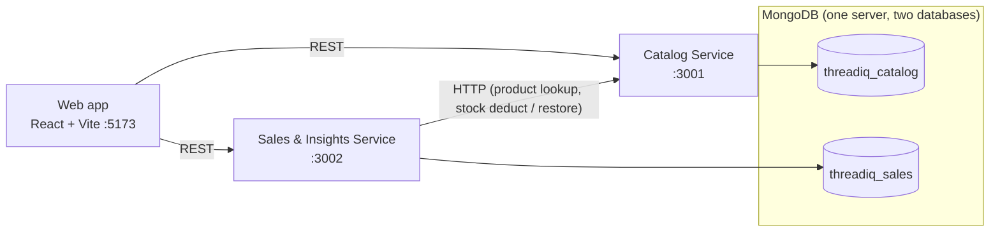

<div align="center">

# 🧵 ThreadIQ

### Smart Fashion Inventory & Trend Analytics

Inventory, sales and explainable trend analytics for small clothing boutiques — built as a TypeScript microservices monorepo.


</div>

---

## Table of contents
[Overview](#overview) · [Features](#features) · [Architecture](#architecture) · [Quick start](#quick-start) · [Run & test](#run--test-docker-only) · [API](#api) · [Project structure](#project-structure) · [Data model](#data-model) · [Analytics rules](#analytics-rules) · [Limitations](#known-limitations) · [Roadmap](#roadmap) · [More docs](#more-documentation)

## Overview
Small boutiques often track stock in spreadsheets, so stock drifts from reality, slow sellers tie up cash and bestsellers run out unnoticed. ThreadIQ keeps one source of truth for **catalogue, stock and sales** and turns it into **explainable** signals: best sellers, slow movers, trend scores and restock suggestions.

It is also a learning project that demonstrates **CRUD, REST design, MongoDB, microservices, inter-service HTTP calls, Docker/Compose and data analytics**.

## Features
- **Dashboard** — active products, units, inventory value, revenue, units sold, AOV, low/out-of-stock counts, revenue trend (daily/weekly), sales by category, best sellers, slow movers, recent sales, restock list. All from real data, with the period shown.
- **Products** — CRUD with size/colour variants, search, filter, sort, pagination, archive/restore with confirmation.
- **Inventory** — receive stock, adjust with a reason, per-variant reorder levels, low/out-of-stock alerts, full movement history. Stock can never go negative.
- **Sales** — multi-line sales, server-side prices and totals, discounts, idempotent submissions, history with date filters.
- **Analytics** — revenue, gross vs discounts, category performance, **trend score (0–100)**, **slow-moving detection**, **restock recommendations** with the maths shown.
- **Engineering** — atomic stock updates, saga-style compensation, OpenAPI docs, health checks, structured logs, rate limiting, 92 automated tests.

## Architecture

| Service | Owns | Notes |
|---|---|---|
| **web** | UI | React 19, Tailwind, TanStack Query, React Hook Form + Zod, Recharts |
| **catalog-service** | products, variants, stock, stock movements | atomic conditional stock updates |
| **insights-service** | sales, analytics | calls Catalog over HTTP; idempotency + compensation |
| **mongo** | data | named volume, not published to the host |

**Sale workflow:** replay check → validate against catalog → compute totals on the server → atomic stock deduction → save sale → if saving fails, restore stock. Details in [explain.md](explain.md) and [docs/architecture.md](docs/architecture.md).

## Quick start
**Prerequisite:** Docker Desktop running.
```bash
git clone <your-repo-url> threadiq && cd threadiq
docker compose up --build -d                      # mongo + catalog + insights + web
docker compose --profile tools run --rm seed      # load demo data (resets demo collections)
```
Open **http://localhost:5173**.

| URL | What |
|---|---|
| http://localhost:5173 | Web app |
| http://localhost:3001/api-docs | Catalog API (Swagger UI) |
| http://localhost:3002/api-docs | Insights API (Swagger UI) |

Stop: `docker compose down` (data kept) · wipe data: `docker compose down -v`.
Full step-by-step guide with troubleshooting: **[run.md](run.md)**.

## Run & test (Docker only)
Everything — app, services, MongoDB, seeding and tests — runs in containers. **No Node.js, npm or MongoDB is needed on your machine.**
```bash
docker compose --profile tools run --rm smoke     # end-to-end check against the running stack
docker compose --profile tools run --rm test      # type-check + 92 automated tests (throw-away test databases)
docker compose up --build -d web                  # rebuild one service after changing its code
docker compose logs -f catalog-service            # logs
```
Configuration is a single optional root `.env` (copy of `.env.example`). Covered by the tests: validation, duplicate SKUs, negative stock, **concurrent deductions**, idempotency, compensation, downstream failures (down / timeout / 5xx), server-side totals, analytics on known data, zero-history and zero-denominator cases.
Building images by hand, pushing to GitHub and publishing to Docker Hub are covered step by step in **[run.md](run.md)**.

## API
Base path `/api/v1`. Responses: `{ "data": … , "meta": … }` or `{ "error": { "code", "message", "details" } }`.

| Catalog Service (:3001) | |
|---|---|
| `GET/POST /products`, `GET/PATCH/DELETE /products/:id` | products (DELETE archives) |
| `POST /products/:id/variants`, `PATCH /products/:id/variants/:variantId` | variants, reorder level |
| `GET /inventory/low-stock`, `GET /inventory/movements`, `GET /inventory/summary` | alerts, history, KPIs |
| `POST /inventory/receipts`, `POST /inventory/adjustments` | stock changes |
| `POST /inventory/sale-deductions`, `POST /inventory/sale-restorations` | internal, idempotent |

| Sales & Insights Service (:3002) | |
|---|---|
| `GET/POST /sales`, `GET /sales/:id` | sales (`Idempotency-Key` required on POST) |
| `GET /analytics/overview` · `revenue-trend` · `category-performance` · `top-products` | KPIs and charts |
| `GET /analytics/slow-moving` · `trend-scores` · `restock-recommendations` | insights |

Complete reference with examples: [docs/api-reference.md](docs/api-reference.md).

## Project structure
```
threadiq/
├─ apps/web/                    React SPA (features: dashboard, products, inventory, sales, insights)
├─ services/
│  ├─ catalog-service/          config · models · repositories · services · controllers · routes · validators · middleware
│  └─ insights-service/         … plus clients/ (Catalog HTTP client) and analytics/ (pure calculations)
├─ scripts/                     seed.ts (deterministic demo data), smoke.ts
├─ docs/                        architecture.md · api-reference.md · demo-guide.md
├─ docker-compose.yml           full stack + one-off jobs (seed, smoke, test)
├─ docker-compose.hub.yml       run the stack from Docker Hub images
├─ docker/test.Dockerfile       test-runner image
└─ run.md · explain.md          how to run · concepts & core logic
```

## Data model
- **products** — name, sku (unique), brand, category, description, sellingPrice, costPrice, status, `variants[]` {sku (unique), size, color, stock ≥ 0, reorderThreshold}
- **stockmovements** — type (receipt / adjustment / sale / return), signed `quantityChange`, `balanceAfter`, reason, reference
- **sales** — saleNumber (unique), idempotencyKey (unique), item snapshots (name, sku, price, qty), subtotal, discount, total

## Analytics rules
- **Revenue** = gross sales − discounts · **AOV** = revenue ÷ orders
- **Trend score** = 60% sales velocity + 25% growth vs previous window + 15% stock urgency (each 0–100, clamped); windows 14 + 14 days
- **Slow-moving** (30 days): *no sales history* · *no recent sales* · *low velocity*; out-of-stock and brand-new products are never labelled slow
- **Restock**: flag if stock ≤ reorder level or cover < 14 days; suggested = 30 days of demand + reorder level − stock

These are transparent **rule-based heuristics — not machine learning or validated forecasts.** Formulas: [docs/architecture.md](docs/architecture.md).

## Known limitations
- No authentication/authorization (MVP scope).
- Sales ↔ stock is a saga, not a distributed transaction: a crash between deduction and saving leaves stock deducted until the same request is retried (safe, idempotent). No background reconciler.
- Single-node MongoDB (no replica-set transactions); single currency (INR), UTC dates; no payments, tax or refunds.
- `npm audit` lists advisories in dev tooling (Vitest, Tailwind 3 build chain) and zod 3 (mitigated by a 100 KB body limit).

## Roadmap
JWT auth & roles · outbox/reconciler for sales↔stock · purchase orders and supplier lead times · returns/refunds · barcode scanning · CSV import/export · seasonality-aware forecasting · CI pipeline and browser e2e tests.

## More documentation
| File | Contents |
|---|---|
| [run.md](run.md) | Step-by-step, Docker only: build, run, seed, test, GitHub, Docker Hub, troubleshooting |
| [explain.md](explain.md) | Concepts and the core logic behind the code (viva-friendly) |
| [docs/architecture.md](docs/architecture.md) | Architecture, failure handling, analytics formulas |
| [docs/api-reference.md](docs/api-reference.md) | Endpoint contract |
| [docs/demo-guide.md](docs/demo-guide.md) | 10-minute demo script |

## License
Educational project. Add a `LICENSE` file (e.g. MIT) before publishing if you want to specify terms.
